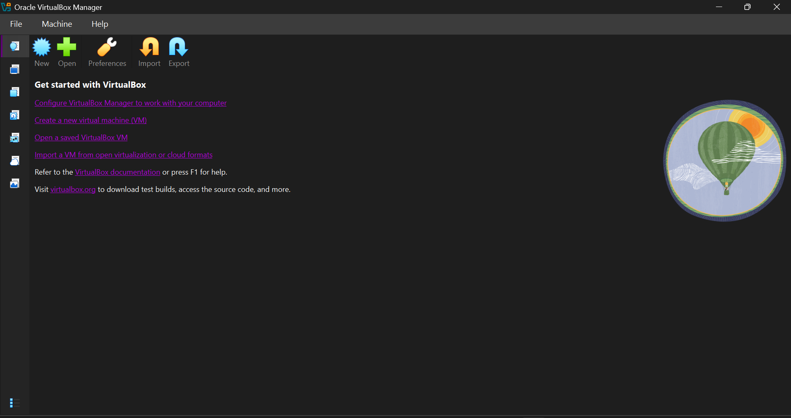
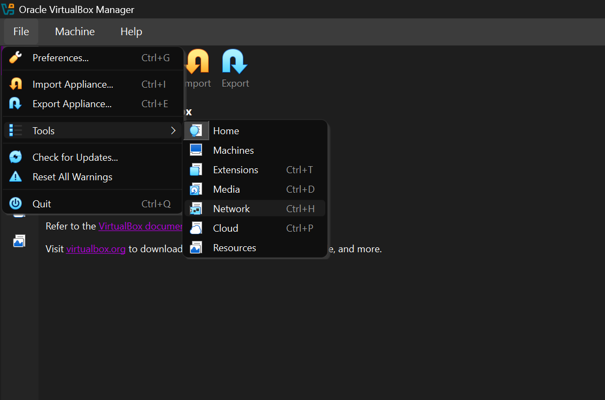
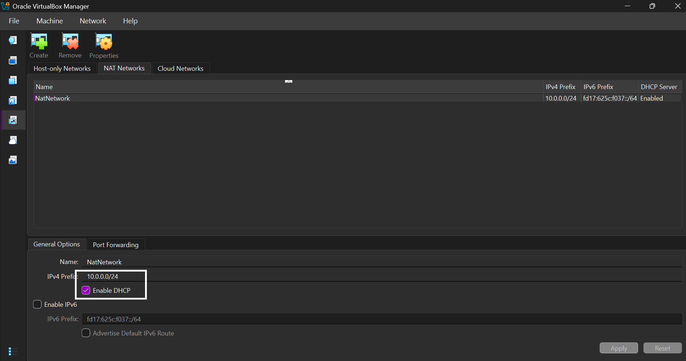
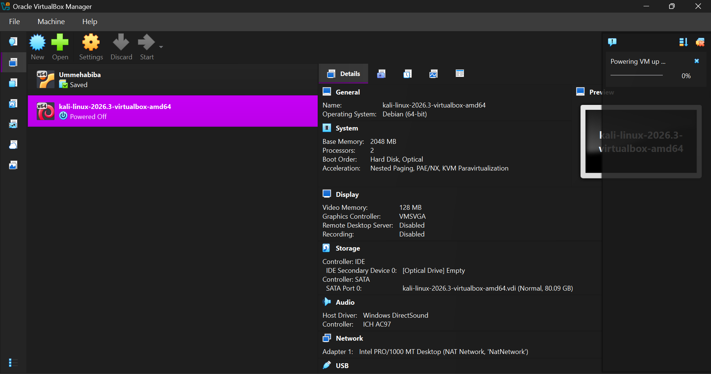
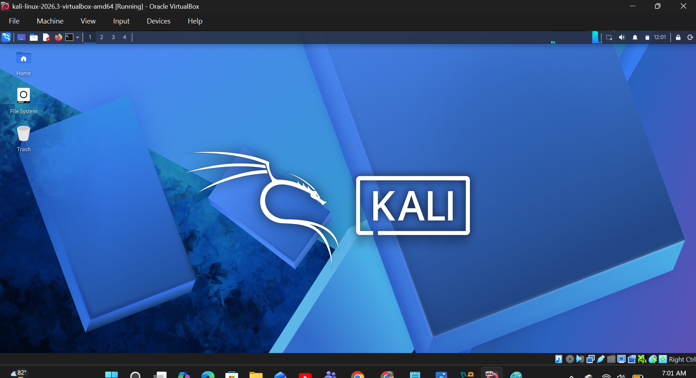
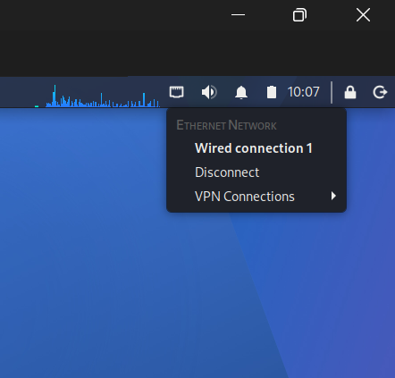
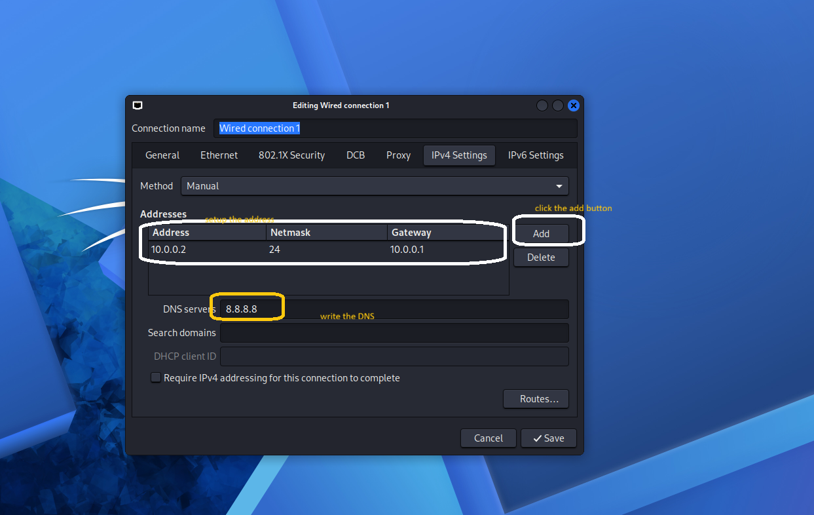
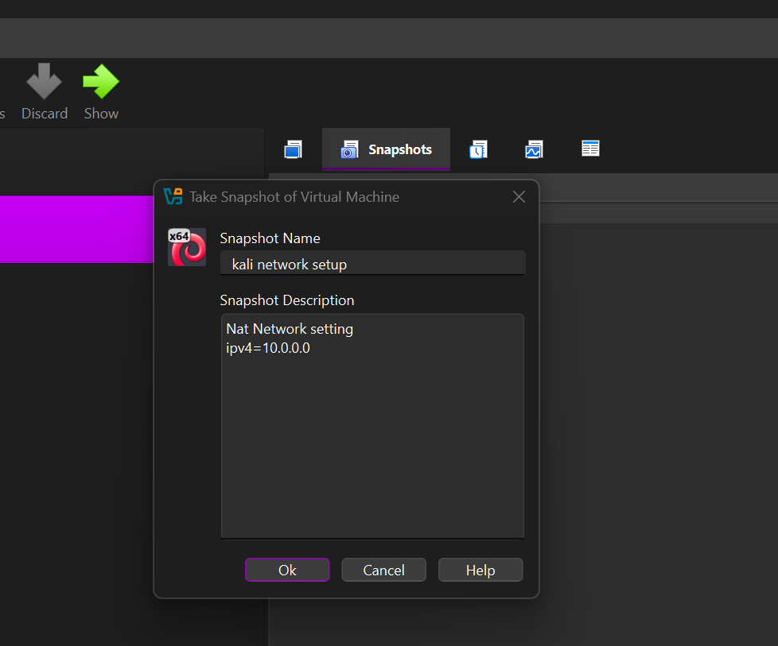
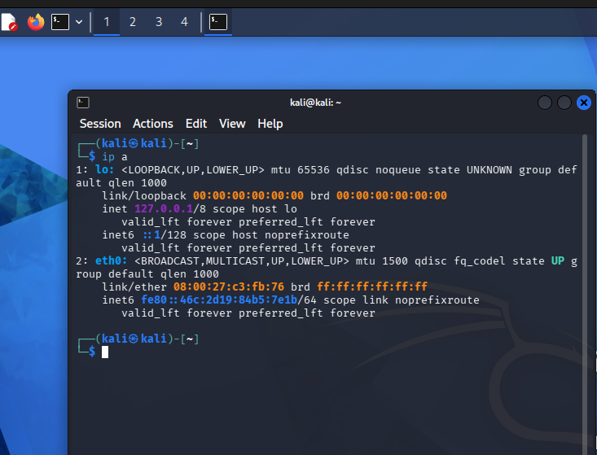

# 🔐 Cybersecurity Home Lab Setup with Kali Linux & VirtualBox

Building a virtual lab environment for cybersecurity learning, network analysis, and ethical penetration testing.

## 📌 Project Overview

This project demonstrates how to build a virtual cybersecurity lab using Oracle VirtualBox and Kali Linux.

The goal is to create a controlled environment for learning cybersecurity fundamentals, exploring network security tools, performing network reconnaissance, and practicing authorized security assessments.

The lab uses a VirtualBox NAT Network to support communication between virtual machines while providing outbound network access. Additional VMs can be introduced later for practical security exercises.

## 🎯 Project Objectives

- Install and configure Oracle VirtualBox.
- Set up Kali Linux as a virtual machine.
- Create a dedicated NAT Network for the lab.
- Configure and verify Kali Linux network settings.
- Establish consistent IP addressing for lab machines.
- Test network connectivity and DNS resolution.
- Create a baseline snapshot for recovery.
- Document the installation process and troubleshooting steps.
- Prepare the lab for future cybersecurity experiments.

## 🏗️ Lab Architecture

The lab consists of a host computer running VirtualBox, with Kali Linux connected to a dedicated virtual NAT Network.

Additional virtual machines can be connected to the same network for isolated, authorized testing.

## ⚙️ Environment Specifications

| Component | Configuration |
|---|---|
| Host Operating System | Windows 10 |
| Virtualization Software | Oracle VirtualBox 7.2 |
| Security Distribution | Kali Linux |
| Network Mode | NAT Network |
| Network Prefix | 10.0.0.0/24 |
| Default Gateway | 10.0.0.1 |
| DNS Server | 8.8.8.8 |

*Note: These values describe the planned lab configuration. Verify them against your actual VirtualBox and Kali settings before publishing.*

## 🪜 Installation and Configuration

### Step 1: Install 7-Zip

Install 7-Zip if needed to extract the downloaded Kali virtual machine archive.

Download: https://www.virtualbox.org/wiki/Downloads

### Step 2: Set Up VirtualBox

Download and install Oracle VirtualBox. Confirm that hardware virtualization is enabled if your system requires it.

Download: https://www.virtualbox.org/wiki/Downloads

## 📸 virtual box Configuration

### Step 3: Configure a Dedicated Virtual Network

Create a NAT Network in VirtualBox with the following settings:

## 📸 Network setup

- **Network Name:** NatNetwork
- **IPv4 Prefix:** 10.0.0.0/24
- **DHCP:** Enabled
- **IPv6:** Disabled

A NAT Network can allow connected virtual machines to communicate with one another and access external networks through network address translation.

### Step 4: Import Kali Linux

Download the appropriate Kali Linux VirtualBox image from the official website and import it into VirtualBox.

Download: https://www.kali.org/get-kali/

## 📸 Kali Linux Configuration

Configure the virtual machine:

- **Network Adapter:** Adapter 1
- **Attached To:** NAT Network
- **Network:** NatNetwork
- **Adapter Type:** Intel PRO/1000 MT Desktop
- 
A shared folder may also be configured for transferring files between the host and the virtual machine. Use appropriate permissions when sharing files.

## 📸 Kali Linux complete setup

### Step 5: Configure Network Connectivity

Inspect the network interfaces and IP configuration from Kali Linux:

## 📸 Network connectivity configuration

If a static IP address is required, configure it through the appropriate NetworkManager connection settings.

Example target configuration:

- **IPv4 Address:** 10.0.0.2/24
- **Gateway:** 10.0.0.1
- **DNS:** 8.8.8.8

Ensure the chosen address does not conflict with another device or a DHCP-assigned address. The gateway and DNS settings must match the actual virtual network configuration.

## 📸 address and DNS setup

### Step 6: Create a Baseline Snapshot

Once the operating system and network configuration are working, create a snapshot in VirtualBox.

## 📸 snapshot

**Suggested snapshot name:** `Kali Network Setup`

This snapshot provides a recovery point before future experiments or configuration changes.

## 🔎 Verification and Testing

Run the following checks to confirm the basic lab configuration.

| Check | Command | Purpose |
|---|---|---|
| IP configuration | `ip a` | Inspect assigned IP addresses |
| Routing table | `ip route` | Verify the default route |
| Gateway connectivity | `ping -c 4 10.0.0.1` | Test reachability of the gateway |
| Snapshot recovery | Restore the baseline snapshot | Verify recovery capability |

*Expected results depend on the actual network settings. A failed ping does not always mean the network is broken because ICMP traffic may be blocked.*
 
## 📸 command

## 🔒 Security and Responsible Use

This lab is intended for cybersecurity education and authorized testing only.

- Use intentionally vulnerable machines for practice.
- Keep experimental targets within the intended lab network.
- Verify network exposure before introducing additional VMs.
- Take snapshots before significant changes.
- Never test systems without permission.

## 🔗 Official Tools and Resources

- [7-Zip Downloads](https://7-zip.org/download)
- [Oracle VirtualBox Downloads](https://www.virtualbox.org/wiki/Downloads)

## 👤 Author

Umm e habiba

[GitHub Profile](https://github.com/Habiba-khan155)

[Linkedin Profile](www.linkedin.com/in/umm-e-habiba1556)

## 📚 Project Details

- **Project:** Cybersecurity Lab Environment Setup
- **Module:** Virtualization and Linux Networking
- **Week:** 01
- **Platform:** GitHub
- **Tools:** VirtualBox, Kali Linux 

---

*This repository documents the initial lab setup and can be extended with future network security and penetration-testing exercises.*
